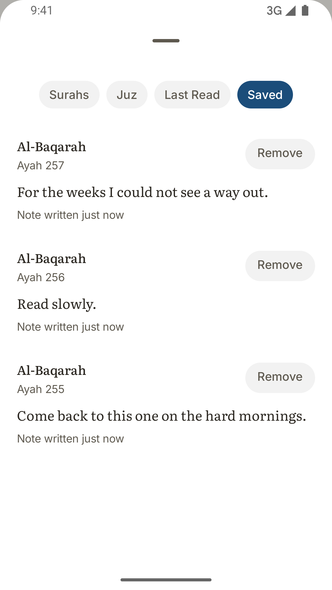
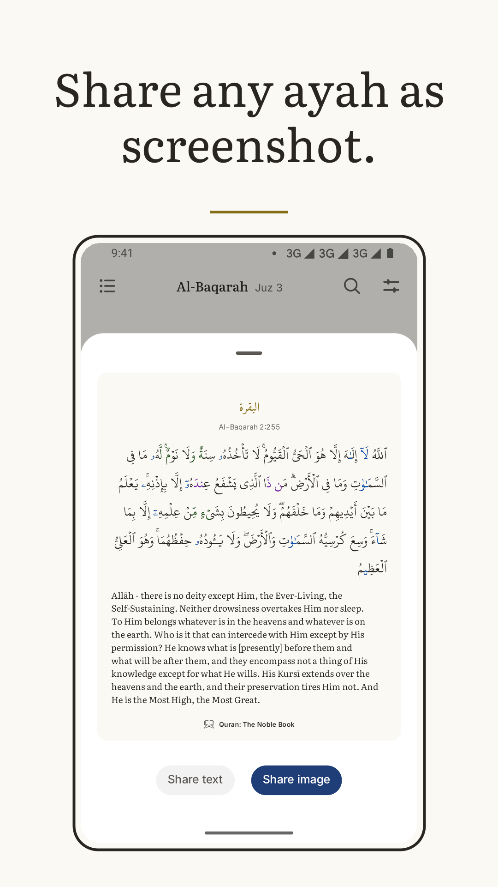
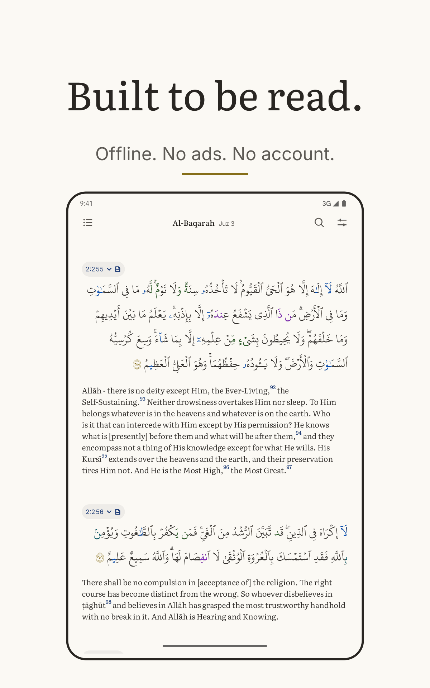
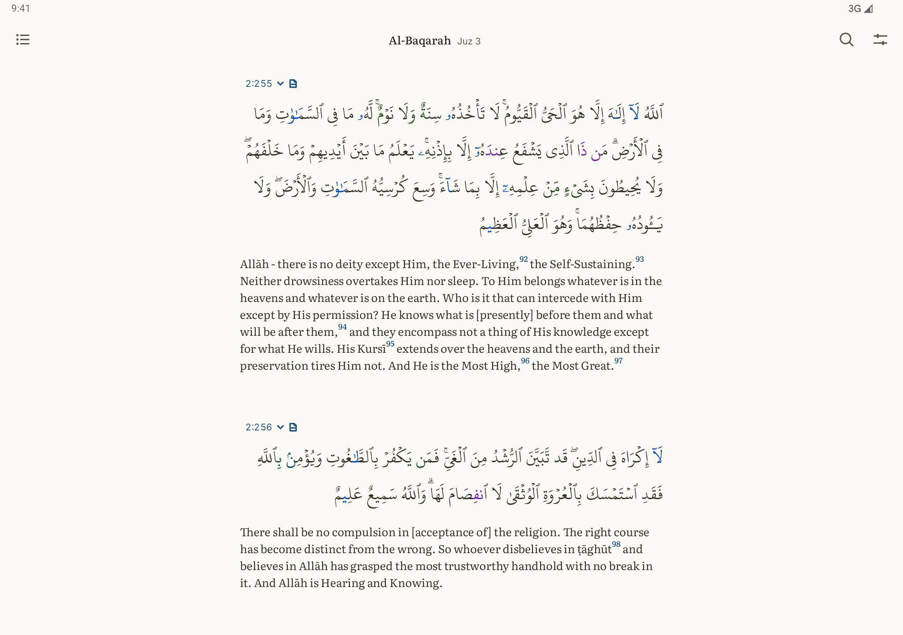

# Quran: The Noble Book


A free Quran reader for Android, built to be read. It opens on the ayah you
left, with the QPC Hafs text, color-coded tajweed, the Saheeh International and
Al-Bayan translations, word-by-word meanings with roots and grammar, Tafsir Ibn
Kathir, and recitation by Minshawi and Husary. In
English and বাংলা.

There is one reading and no home screen. No ads, no trackers, no accounts, and
no network beyond the project's own release page.

- **Platform:** Android 7.0 and newer (API 24), phone and tablet, either orientation
- **Package:** `io.github.muntasimulhaque.quran`, app name `Quran`
- **Price:** free, no ads, no purchases, no account
- **License:** MIT for the code; each content dataset keeps its own, recorded in [`content/manifest.json`](content/manifest.json)
- **Privacy policy:** [online](https://muntasimulhaque.github.io/quran/privacy.html) · [in this repo](docs/privacy.html)

<p align="center">
  
  
  
  
</p>
<p align="center">
  
  
  
  
</p>

The same reading on a 7 inch and a 10 inch tablet:

<p align="center">
  
  
</p>

Every screen inside every card is a real capture from an Android system, taken
by the project's own screenshot test on a phone and on two tablets. The card
around it, its caption, its gold rule, and its device outline are drawn by the
project's own tools from the app's own fonts and the theme's own colors. No
screen is a mockup.

## The reading

The app opens where you left off. The bar is the page's head: it carries the
surah and the juz, it steps aside as you read forward, and it comes back on your
first backward scroll or a tap. Browse, Search, and Settings are raised from it
as sheets, so nothing stands between you and the text.

| | |
|---|---|
| **The page** | The QPC Hafs print, word by word, set in the King Fahd Complex's own typeface. Every ayah's number is the door to its card. |
| **Translations** | Saheeh International in English and Al-Bayan in Bangla ship inside the app, so the first page is readable offline with no download and no language screen. More than one may be on at once, and each column says which pack it is. |
| **Tajweed** | The printed mushaf's seven color families, drawn on the words themselves, with a Tajweed page that explains every color and its rules in English and Bangla. |
| **Word by word** | Press and hold any word for its meaning, its root, its dictionary form, its grammar, and its own pronunciation. A root or a form counts every place it stands in the Book, and a tap on one moves the reading there. |
| **Tafsir** | Ibn Kathir opens in the ayah card, in English or Bangla, with the Quran quotations set apart from the commentary. |
| **Search** | Arabic is read without diacritics, and a spelling the print does not carry still finds its verse; English is read without accents. A reference like `2:255` or `kahf 10` goes straight to the ayah. Search in the Quran text, translations, word meanings, tafsirs, your notes, surah names, or references. |
| **Saved and notes** | Keep any ayah, write your own note on it, and find both again under Browse. Last Read keeps the places you have been reading, newest first. |
| **Recitation** | Minshawi and Husary, with the page following the reciter and the word being recited washed as it sounds. Five speeds, repeat the ayah or the surah, stop after this ayah, or continue to the next surah. |
| **Share** | Send the verse as text, or as one image card in the app's own paper and type. |
| **Daily ayah** | One ayah a day at a time you choose, dealt by the day number from a reshuffled deck of all 6,236. A notification, no streaks and no guilt. |
| **Links** | A `quran://ayah/2:255` link opens that verse. |
| **Type and theme** | Light, dark, or the phone's own setting, with five sizes each for the Quran text, the translation, and the tafsir, and the system font scale honored on top of them. |

## Reader first

- **No screen before the text.** No wizard, no dialog, and no feature that
  asks for a choice before the reading. A cold start lands on readable text
  with no spinner, and the reading is a scroll through rows already measured.
- **The chrome steps aside.** There is no home screen, no dashboard, and no
  permanent tab bar. The bar carries the place and is the page's head, and it
  leaves as you read forward.
- **Built for TalkBack.** Every control is named, an ayah's card is spoken as
  one, and the reading works end to end without sight.
- **Measured, not eyeballed.** Contrast targets live in the theme and a test
  measures them. The seven tajweed families sit in one band of lightness, so
  no rule outshouts its neighbor over a long sitting.
- **Nothing borrowed.** Every icon is drawn for this app, the switch and the
  pill are its own shapes, and the typefaces are chosen rather than inherited
  from the platform.

## What ships inside, and what arrives on your word

The Book is here before the first tap. The app installs with the QPC Hafs text
and its tajweed, both translations, the surah names, the recitation timings for
every reciter, and Al-Fatiha's audio in the default voice, so the first Play
on 1:1 works with the phone in airplane mode.

Everything else is fetched from this project's GitHub Releases, only when you
ask for it:

| What | When | Size |
|---|---|---|
| Tafsir Ibn Kathir | When you open the ayah card and ask for it, in the language you read | 30 MB English, 56 MB Bangla |
| Word meanings | With the switch that turns word by word on | 11 MB English, 13 MB Bangla, plus 3 MB of roots |
| Word pronunciation | The surah being read, when you press a word's speaker or turn the feature on | 352 MB for the Book, one surah at a time |
| Recitation | One surah, after you see its size and tap Download (Al-Fatiha is already here in Husary's voice) | Under 1 MB to 186 MB for Al-Baqarah |

A pack you already hold refreshes quietly when a newer version of the app ships,
on an unmetered connection only, and only after the first page is readable.
Nothing is ever streamed: a downloaded surah works offline forever after.

## Private by construction

- **No ads, no trackers, no analytics, no crash reporting, no accounts.** There
  is no third-party SDK. The reader's own work, the saved ayahs, the notes, and
  the reading place, never leaves the phone.
- **No backup, no export, no import.** The app asks the platform not to copy its
  data, on old and new Android alike.
- **Six permissions, each with one reason.** `INTERNET` for content from this
  project's releases, `POST_NOTIFICATIONS` for the daily ayah, the two
  foreground-service permissions for recitation, `SCHEDULE_EXACT_ALARM` for a
  reminder at the minute you chose, and `RECEIVE_BOOT_COMPLETED` to put that
  reminder back after a restart. `USE_EXACT_ALARM` is deliberately not declared.
  The app asks for the notification once, at the reminder card; it asks for the
  exact time only where the phone withholds it, at the two moments the reminder
  is set.
- **One host.** Every request goes to this project's own GitHub Releases page,
  and to the storage GitHub redirects it to, over HTTPS, carrying nothing but
  the request itself. See the [privacy policy](docs/privacy.html).
- **No WebView.** The reading is native Jetpack Compose end to end.

## Two languages, one Book

English is the default and the fallback, and the app follows the phone's
language silently: no language screen stands before the reading. English and
Bangla ship together, interface and content alike, including Tafsir Ibn Kathir
and the word meanings, with the surah names written in Bengali script. A reader
who wants the other language chooses it in Settings, where it also sets the
translation, the tafsir, and the word meanings. On Android 13 and later the
same choice stands in the phone's own per-app language settings, and either
row sets the other. Arabic is data, not a locale, so
right-to-left stays on.

## The Book is not ours to change

Not one byte of the Quran text, the translations, or the tafsir is edited by
hand. Every dataset travels through `tools/`, which verifies and rebuilds the
content database, and each one records its source, version, checksum, and
license in [`content/manifest.json`](content/manifest.json), the one place those
facts live. The app's About page reads that record and names every source.

| Dataset | Source | Terms, as the source gives them |
|---|---|---|
| Quran text and tajweed | King Fahd Glorious Quran Printing Complex, via the Quranic Universal Library | Free for Islamic use |
| Saheeh International | Noor International Center, via QuranEnc, version 1.1.2 | Republishing terms: unchanged, credited, version shown, footnotes kept |
| Al-Bayan Simple Translation | Al-Bayan Foundation Bangladesh, via QUL and IslamHouse | Free to copy and distribute unchanged, never for sale |
| Tafsir Ibn Kathir, English and Bangla | Quranic Universal Library by Tarteel | QUL lists no license; rights unverified |
| Word by word and word roots | Quranic Universal Library | QUL lists no license; rights unverified |
| Grammar and dictionary forms | Quranic Arabic Corpus by Dr. Kais Dukes, via Quranpedia | GNU GPL, attribution required |
| Recitations | Sheikh Muhammad Siddiq Al-Minshawi and Sheikh Mahmoud Khalil Al-Husary, via QUL, with word timings by quran-align | QUL lists no license for the recordings; timings CC BY 4.0 |
| Word pronunciation | Mishari Rashid al-Afasy, via QUL, with word timings by quran-align | Audio: rights unverified; timings: CC BY 4.0 |
| Uthmani reference text | Tanzil Project | CC BY 3.0, unmodified, credited |
| Bangla surah names | Compiled and reviewed for this app after Dr. Abu Bakr Muhammad Zakaria's index | No verse text is copied |

**A note on the footnotes.** Saheeh International's note 403 is missing from the
source of 7:143: both QuranEnc and the QUL copy carry 401 and 402 and no 403.
The app draws 403 as a plain superscript that opens nothing, and no note was
invented to fill the gap. A verified note from a Saheeh source would travel
through `tools/` like every other content change.

## Build it

`JAVA_HOME` must point at the Android Studio JBR; it is not on `PATH`.

```bash
export JAVA_HOME="/c/Program Files/Android/Android Studio/jbr"

# the release gates: the JVM suite, the content gates, the store cards, lint
./gradlew :core:test :tools:test :data:testDebugUnitTest :ui-kit:testDebugUnitTest \
  :feature-browse:testDebugUnitTest :feature-playback:testDebugUnitTest \
  :app:testDebugUnitTest :app:lintDebug :app:assembleDebug
./gradlew :tools:run --args="checkdb"
./gradlew :tools:run --args="search"
./gradlew :tools:run --args="storecards --check"

# the content pipeline, every step and its arguments
./gradlew :tools:run --args="help"
```

An Android SDK is needed, and `local.properties` must carry its `sdk.dir`. A
release build signs from a keystore outside the tree and degrades to unsigned
when that keystore is absent, so a fresh clone still builds. Some content gates
read `content/raw/`, the owner's own exports, which are not in the repository.

## How the code is laid out

| Module | What is there |
|---|---|
| `core/` | Pure JVM Kotlin, zero `android.*`: references, search normalization, rich text, the deck, the models |
| `data/` | Read-only content access, the downloads that fetch a pack from this project's Releases, the saved-ayah and last-read stores, preferences |
| `ui-kit/` | The theme and palettes, the hand-drawn icons, the shared rows and shapes, the rich text and tajweed views, the small formatters |
| `feature-reading/`, `feature-search/`, `feature-browse/`, `feature-playback/`, `feature-settings/` | One surface each: the reading, the search sheet, Surahs and Juz and Last Read and Saved, the pill and the player, the settings hub and its pages |
| `app/` | The shell: the one activity, the view model, the screen that composes the features, the daily ayah's scheduler and notification |
| `content-assets/` | The typefaces the app ships |
| `tools/` | The offline pipeline that builds every dataset, and `tools/icons/forge.py`, which draws every icon and the feature graphic |
| `benchmark/` | The startup profile's generator, development only, never in the bundle |

Every settled design decision lives in the KDoc beside the code it decided,
tagged `owner decision`, and a test measures the ones that can be measured, so
`git grep "owner decision"` is the record of why the app is the way it is.

## Status

**22.7 (versionCode 229).** The word follow is measured now (owner
decision, 22.7). The whole JVM suite, `verify`, `checkdb`, `search`,
`storecards --check`, lint, and `assembleDebug` were green on this machine.
The diff touches `feature-reading/` and the reading's own screen, so the four
accessibility classes were owed; they ran on `quran_phone` as a clean install,
ten cases and no failures. No visible surface changed for a still frame, so
the three committed store sets stand and no capture leg ran.
`content/quran.db` hashes
`0c5d878e8240f014dea651b7912695092eb0eac1da071a6d55056fce9272904e`
and was rebuilt twice to the byte. The voice edges were re-measured in the
same change, one line per file taken from the file's whole energy: the old
head window read a first voice from decoder noise on the ayahs that open in
more silence than it held, and its tail windows measured the last voice
hundreds of milliseconds into closing pauses, on 518 ayahs. The table's hash
moved with it and is pinned in the manifest. The core pack stays at version 8
and publishes as `pack-core-d7407645`, its rows unchanged; the two reciter
packs moved to `reciter-husary b9b25a95f10c` and `reciter-minshawi
09beaef021c8`. `tools audio words` measured 494 ayahs of each voice against
their own audio: the boundary error's median is 40 ms for Husary and 50 ms
for Minshawi, and the ninetieth percentile is 140 ms and 120 ms.

**What changed in 22.7.** The page follows the reciter by measured time
(owner decision, 22.7). The word timings of both recitations were cut against a
different edit of the recordings than the files the app plays: on 284 Husary and
283 Minshawi ayahs the first region began up to a second after the voice, so the
page rested through the first word, and the boundaries inside an ayah wandered
by a median of about half a second. Both voices now read cpfair's quran-align
timings, cut against the same takes the app ships and verified against their
audio, and the page's word stands within tens of milliseconds of the voice.
Three smaller rules came with it: a one-word ayah, which is every muqata'ah
that stands alone, now spans its file's whole voice instead of the aligner's
guess; the wash rests at the last sound's own millisecond, so the last word no
longer stands through the closing pause when the reading wakes exactly on it;
and the wash carries its ayah, so a turn can no longer light a word on the
wrong row for a frame. `tools audio words` measures a sampled ayah against its
own audio for both voices, and `checkdb` compares every first region to the
measured voice. The voice edges were re-measured in the same
change: one line per file, taken from the file's whole energy instead of a
window that decoder noise could fool, which pulled 518 closing pauses back out
of the last word's wash and put every head that opens in long silence at its
true voice. The Quran text, both translations, both tafsirs, the word
lists, and the word pronunciation pack are unchanged.

**What changed in 22.6.** The app offers two recitation voices, Husary and
Minshawi (owner decision, 22.6). Alafasy and Abdul Basit are retired: their
catalog rows, shipped timing packs, database rows, voice edges, source pins,
published manifest entries, About page credits, and tests are gone, and the
core pack moves to version 8, whose recitation map names the two voices the
catalog offers. The word pronunciation pack is unchanged. The Quran text,
both translations, both tafsirs, and the word lists are unchanged.

**What changed in 22.5.** Search says what the reader meant (owner
decision, 22.5). A reader who typed `bakara` was offered `banana`, because
the surah they meant was not in the vocabulary the suggestion is chosen
from and the fruit was the only word within two edits; the surahs' names
are part of that vocabulary now, offered as the name the interface draws,
so `bakara` comes back as one tap on `Al-Baqarah`. A Latin term of five
letters and up is ranked by how it sounds before how it is spelled: `q`
folds into `k`, the vowels a transliteration never agrees on fall away, and
a final `h` falls away with them, so `bakara` and `baqarah` are one shape
and `koran` and `quran` another. A word that only sounds vaguely near is
refused rather than offered. The surah match reads the keys a name may be
typed by, so `yasin` finds Ya-Sin and `albaqarah` finds Al-Baqarah, whose
stored names carry a hyphen the reader does not type, and the word `surah`
no longer hides the surah it introduces: `surah baqarah` opens Al-Baqarah.
The vocabulary is counted in the index's own tokens, so a count is a count
of what search matches. The Quran text, both translations, both tafsirs,
the recitations, and the content database are unchanged.

**What changed in 22.4.** The store set is the app's own face (owner
decision, 22.4). The eight screenshots Play shows are cards now: each is a
real capture from the screenshot test, whole and unedited, laid on the app's
own paper inside an outline drawn in its ink, under one line set in the app's
Literata with the app's Inter beneath it. The card's gold rule is the feature
graphic's, so the icon, the graphic, and the cards read as one face.
`./gradlew :tools:run --args="storecards"` composes all three sets from the
captures committed under `play-store/frames/`, and `storecards --check` is a
release gate: it compares the pictures the command would draw with the ones
the repository holds, at a tolerance wide enough for a platform's own font
rasterizer and narrow enough that one changed word fails. The app itself is
unchanged, and the accessibility classes were not owed: the diff touches
`tools/`, `play-store/`, and the records, and no path the trigger names.

## Corrections and contributions

Please say so; it is far more use as an issue than as a review. Open a
[content correction](https://github.com/muntasimulhaque/quran/issues/new) with
the reference (`2:255`), what the app shows, and what it should say. From inside
the app, About, then Send feedback, opens an email instead.

Pull requests are welcome. A change to the reading must keep the gates above
green and is checked against the decisions in the KDoc. Content is never edited
by hand: it changes through `tools/`, with its source, version, checksum, and
license recorded.

## License

**The code is MIT**: see [LICENSE](LICENSE). Take it, build on it, ship it.

**The content is not ours to license.** Every dataset in `content/` belongs to
the source that published it, under the terms that source states, and those
terms are recorded per dataset in [`content/manifest.json`](content/manifest.json)
and shown in the app's About page. Nothing in the MIT grant covers the Quran
text, the translations, the tafsir, the recitations, or the word lists.

**The typefaces** are the SIL Open Font License 1.1 for six of them, and the
King Fahd Complex's own terms for the Hafs face, which ships unmodified and is
never sold. See [licenses/](licenses/).
